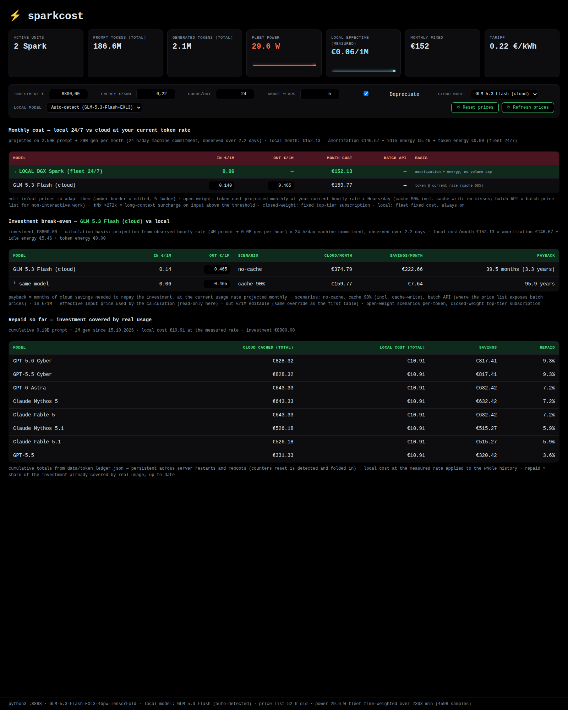

# sparkcost ⚡

**Token economics: local inference on an NVIDIA DGX Spark (GB10) fleet vs cloud LLMs.**

A self-hosted token-economics tool that answers one precise question: *given the tokens you actually generate, what would they cost in the cloud, and how long does the hardware take to pay for itself?* Nothing is estimated by hand: tokens come from real inference-server counters, power is sampled from `nvidia-smi`, cloud price lists are downloaded (LiteLLM catalog, cross-checked against aitokenprice.com), and the whole accounting is recomputed on every dashboard tick.



*The dashboard: live cards (tokens, fleet power, effective €/1M), monthly-cost comparison against the cloud peer set, investment break-even with payback times, and the cumulative "repaid so far" ledger.*

```
┌────────────┐   /metrics     ┌──────────────┐
│ tensorfold │ ─────────────► │ collect.py   │  token counters + nvidia-smi
└────────────┘                │  (30s sampler│  → data/sparkcost.sqlite (WAL)
┌────────────┐   power.draw   │  persistent) │
│ nvidia-smi │ ─────────────► └──────┬───────┘
└────────────┘                       │
                                     ▼
┌──────────────┐   price lists ┌──────────────┐   JSON every tick
│ LiteLLM +    │ ─────────────►│ localcost.py │ ─────────────┐
│ aitokenprice │               │  (the engine)│              │
└──────────────┘               └──────┬───────┘              ▼
                               data/config.yaml    ┌─────────────────┐
                               data/token_ledger.json (persistent totals)
                                                   │   serve.py :8900│←— you
                                                   └─────────────────┘
```

## Install & run

Requirements: Python ≥ 3.10, `PyYAML` (the only non-stdlib dependency), `nvidia-smi`, and an inference server exposing a Prometheus-style `/metrics` endpoint (tensorfold/vllm/sglang — the counter prefix is auto-detected).

```bash
pip3 install PyYAML

# 1) dashboard (http://127.0.0.1:8900)
python3 -m sparkcost.serve

# 2) persistent sampler (recommended: systemd user service, see below)
python3 -m sparkcost.collect --loop 30
```

systemd user service (survives reboots; `loginctl enable-linger $USER`):

```ini
# ~/.config/systemd/user/sparkcost-sampler.service
[Unit]
Description=sparkcost sampler
[Service]
ExecStart=/usr/bin/python3 -m sparkcost.collect --loop 30
WorkingDirectory=/path/to/sparkcost
Restart=always
[Install]
WantedBy=default.target
```

## Commands

| Command | What it does |
|---|---|
| `python3 -m sparkcost.serve` | Live dashboard on `:8900` (1s/5s/10s auto-refresh) |
| `python3 -m sparkcost.localcost` | Full text report: local cost, cloud replay, break-even |
| `python3 -m sparkcost.localcost --measure` | Same, plus a 10s measurement window (real tok/s + watts) |
| `python3 -m sparkcost.localcost --json` | Machine-readable output |
| `python3 -m sparkcost.models` | Cloud model catalog (in:out blend, ctx, capability) |
| `python3 -m sparkcost.models --refresh` | Re-download the price snapshot from LiteLLM |
| `python3 -m sparkcost.models --crosscheck` | Verify peer-set prices on **aitokenprice.com** (independent second source, read-only) |
| `python3 -m sparkcost.collect --loop 30` | Sampler: watts + counters into the DB every 30s (feeds time-weighted energy) |
| `python3 -m sparkcost.collect --measure` | 10s window: prefill/decode tok/s + power |

Dashboard API: `/api/summary` (the whole report; `?refresh=1` re-downloads the price list, `?local=KEY` overrides the local model), `/api/crosscheck`, `/api/capex|tariff|hours|amort|depreciation|price` (edit parameters and prices straight from the UI).

---

# How the accounting works

## 1. Data sources (all read live, no mandatory daemon)

- **Tokens**: `GET http://127.0.0.1:<port>/metrics` on the inference server → `prompt_tokens_total`, `generation_tokens_total`, TTFT, MTP. The counter prefix (`tensorfold:` etc.) is auto-detected from the payload.
- **Power**: `nvidia-smi --query-gpu=power.draw` per unit. The default idle (17 W) is a sampled value, not an assumption.
- **Server/uptime**: from `ps` (process name, port, uptime) — used for the pro-rata of energy and amortization over the observed period.
- **Cloud prices**: LiteLLM snapshot (`data/litellm_snapshot.json`) + **cross-check** against `aitokenprice.com/api/models.json` (comparison only, never an override; 0.011 $/1M tolerance). Prices are editable in the UI (stored in `data/price_overrides.yaml`).
- **Parameters**: `data/config.yaml` (capex, tariff, hours, cache rate, subscriptions).

## 2. Monthly local cost — fixed vs variable

```
amortization = fleet_capex / (amort_years × 12)          # e.g. €8,800 / 60 = €146.67/month
idle_energy  = idle_watts × n / 1000 × idle_hours × 30.44 × tariff
               # idle_hours = 24 IF always_on (machines never powered off),
               # otherwise = hours_per_day (same basis everywhere, see note)
token_energy = (measured_watts − idle_watts) × n / 1000 × hours_per_day × 30.44 × tariff

local_month = amortization + idle_energy + token_energy
```

Key accounting rules (verified in external review, P37–P40):

- **Capex belongs to the whole fleet**, never per unit: you pay for all the Sparks, even if you use one.
- **24/7 idle does not scale with `hours_per_day`**: machines draw power even when not generating. `hours_per_day` scales **only** the projected token volume.
- **Time-weighted energy** (P40): if the sampler has ≥5 minutes of samples within the server uptime window, the power used is the integral ∫P dt (trapezoid rule) over those samples — not an instantaneous reading that may land in a burst. Fallback: spot reading. The source in use is always shown in the dashboard (`energy_source: integrated | spot | measure-window`).

## 3. The token ledger — totals that survive reboots

Prometheus counters **reset to zero** on every inference-server restart (or machine reboot). `data/token_ledger.json` (atomic tmp+rename writes) keeps the **historical total**:

- current counter ≥ last seen → normal delta, added
- current counter < last seen → **restart detected**: the current counter is added (no tokens lost; the tail between the last poll and the crash is unrecoverable, negligible at a 30s poll)
- corrupted file → clean restart, the dashboard never blocks

The "prompt tokens (total)" and "generated tokens (total)" cards show the ledger; the **"Repaid so far"** section uses the same total (§6).

## 4. Replay: YOUR tokens on cloud price lists

The same tokens generated locally are replayed against cloud prices, in three scenarios:

```
monthly projection:  pt_m = observed_prompt / uptime_h × hours_per_day × 30.44   (same for gen)

no-cache:   cloud = (pt × price_in + gt × price_out) / 1e6 × usd_eur

cache 90%:  blend_in = (1−ch) × (in + write_price) + ch × cache_read
            where write_price = the list's cache_creation price (or 1.25× input if absent):
            at steady state every MISS is also WRITTEN to cache.

batch API:  the list's *_batches multipliers (OpenAI/Anthropic/Google: −50%)
            applied to input, output and cache prices. Only where the list exposes them.
```

- `usd_eur` from config (default 0.93). `cache_hit_rate` default 0.9 (checked against real price lists: OpenAI/Anthropic 0.1×, DeepSeek 0.032×).
- The local cost of the same period is a **symmetric** pro-rata: real energy (watts × uptime) + amortization share × uptime/30.44 days. Same basis on both sides.
- Closed-weight models (ChatGPT Pro, Claude Max, etc.) enter as the **top-tier subscription** of their vendor (worst case, editable in config), not per token.

## 5. Investment break-even

```
savings/month = cloud_month − local_month
payback       = capex / savings    (if savings > 0; otherwise "never")
```

- `local_month` uses the **same function** as the replay (single source of truth, guaranteed consistency between cards and tables).
- The projected volume is stated explicitly (`projection_basis`), e.g. *"1.3B prompt/month, 24 h/day machine commitment, observed over 12.7 h"* — if the observed rate is a peak, pin the real volume with `monthly_prompt_m` / `monthly_gen_m` in config.
- With `depreciation: false` the payback stays "cash" (full capex in the calculation, zero amortization): the `capex_note` says so in the UI.
- Long-context thresholds (e.g. OpenAI 2× above 272K tokens): informational ⬆ badge, the replay stays on base prices.

## 6. Repaid so far — capex already covered by real usage

```
cloud_equivalent = Σ (historical_tokens × cloud_prices)     # from the LEDGER, cache 90% with write
local_cost       = measured local €/1M × historical_tokens
savings          = cloud_equivalent − local_cost
repaid %         = savings / capex
```

This is the **up-to-date** comparison on the historical total since sparkcost started: it grows with every tick, survives reboots, and proves the savings with real numbers instead of projections.

## 7. Declared conventions (no hidden assumptions)

- **3:1 in:out blend** (`in_out_ratio`): an internal convention for the table comparison; there is no industry standard — stated as such.
- **Cache write 1.25×**: fallback where the list does not expose `cache_creation` (OpenAI's value).
- **30.44 days/month**: annual average.
- **Tariff 0.22 €/kWh**: Eurostat Austria non-household 2025 = 0.241 € incl. taxes; 0.22 is conservative.
- **Straight-line 5-year amortization**: common MACRS/GAAP practice for workstations (3–5 years).
- **Marginal energy vs total draw**: the variable part counts only watts *above idle*; idle sits in the fixed part. No double counting.
- **aitokenprice cross-check**: a consistency report — 26/34 peers aligned to the cent (2026-10-15). Differences are never written into the price list.

## 8. Honest limitations

- The monthly projection is sensitive to the observed rate: a peak window inflates the cloud equivalent (use `monthly_prompt_m` to pin it).
- Integrated energy only covers where samples exist: right after installing the sampler it stays in `spot` mode for ~5 minutes.
- Cloud prices move under your feet: `--refresh` + `--crosscheck` to re-focus them.
- Counters between the last poll and a server crash are lost (30s poll → ~15s average hole per event).

---

## Configuration (`data/config.yaml`)

```yaml
n_sparks: 2                 # active units: multiplies energy and capex
eur_per_kwh: 0.22           # energy tariff (Eurostat AT 2025: 0.241)
usd_eur: 0.93
hardware_total_eur: 8800.0  # TOTAL fleet capex (never per unit)
amort_years: 5.0
depreciation: true
idle_watts: 17              # sampled (16.9–17.9 W, 2026-10-14)
always_on: true             # idle over 24/7 — the machines are never powered off
hours_per_day: 24.0         # time commitment: scales ONLY the projected volume
in_out_ratio: 3             # table-blend convention
cache_hit_rate: 0.9
# monthly_prompt_m: 4000    # optional: fixed volume instead of the projection
subscriptions:              # MAXIMUM tier per vendor (worst case)
  OpenAI:    [{plan: "ChatGPT Pro", usd: 200}]
  Anthropic: [{plan: "Claude Max 20x", usd: 200}]
  Google:    [{plan: "Google AI Ultra 20x", usd: 199.99}]
  xAI:       [{plan: "SuperGrok Heavy", usd: 300}]
```

## Generated files (git-ignored, local data)

| File | Content |
|---|---|
| `data/litellm_snapshot.json` | Cloud price snapshot |
| `data/atp_snapshot.json` | aitokenprice snapshot (cross-check) |
| `data/token_ledger.json` | Historical token totals (persistent) |
| `data/sparkcost.sqlite` | Sampler watt/counter samples (WAL) |
| `data/price_overrides.yaml` | Prices edited by hand from the UI |

## History & verification

Development is tracked in [DEV.md](DEV.md) (P29→P40, with acceptance criteria and external reviews). The accounting has been verified against public sources (GB10 wattage, Austrian €/kWh, depreciation practice) and the calculation chain hand-checked (Kimi break-even: 1.68 months estimated vs 1.69 computed).

## License

Apache License 2.0 — see [LICENSE](LICENSE).
